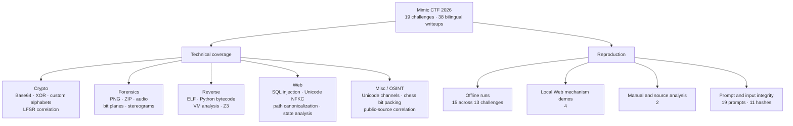

# Mimic CTF 2026 Writeups

A bilingual collection of writeups for all 19 Mimic CTF 2026 challenges, covering Crypto, Forensics, Reverse, Web, Misc, and OSINT. Each entry includes the original prompt, a documented solution, the relevant script, attachment, or forensic image, and a clear statement of what can be reproduced locally.

English is the primary reading path. Complete Chinese translations remain available from every article and challenge entry.

本仓库收录 Mimic CTF 2026 的 19 道题解，覆盖 Crypto、Forensics、Reverse、Web、Misc 和 OSINT。每道题都保留原题、完整解法、对应脚本、附件或取证图，并明确哪些步骤可以在本地复现。英文为主入口，中文版本完整保留。

> This is an independent community collection, not an official Rare Byte Hub publication.
>
> 本文集由参赛者独立整理，不代表 Rare Byte Hub 官方。

[About / 关于](docs/ABOUT.md) · [Reproducibility / 复现](docs/REPRODUCIBILITY.md) · [Event links / 赛事链接](docs/OFFICIAL-LINKS.md) · [Rights / 权利](THIRD-PARTY-NOTICES.md)

## Official links / 官方入口

- [Mimic CTF 2026](https://ctf.rarebytehub.com/events/mimic)
- [Challenges / 题目列表](https://ctf.rarebytehub.com/events/mimic/challenges)
- [Organizer-hosted writeup listing / 组织方文章列表](https://ctf.rarebytehub.com/events/mimic/writeups)
- [Per-challenge and historical Web links / 逐题入口与历史 Web 地址](docs/OFFICIAL-LINKS.md)

## Overview / 项目概览

| Item / 项目 | Details / 内容 |
|---|---|
| Challenges / 题目 | 19 |
| Articles / 文章 | 38 bilingual articles / 38 篇中英双语文章 |
| Prompts and inputs / 原题与输入 | 19 complete prompts and 11 hash-pinned inputs / 19 份完整题面、11 个带 SHA-256 的原始输入 |
| Status / 状态 | Complete, with evidence limits stated in the affected articles / 已完成，并在相关文章中明确证据边界 |
| Verification / 验证 | 19 of 19 offline entries pass; collection, semantic, compilation, and dependency checks pass / 19/19 离线项通过；集合、语义、编译和依赖检查通过 |
| Executable examples / 可执行复现 | 15 offline solver/extractor runs across 13 challenges plus four local Web demos / 15 次离线求解与提取运行覆盖 13 道题，另有 4 个 Web 机制示例 |
| Manual analysis / 手工分析 | Two challenges depend on public-source research or a Telegram workflow; visual readings remain in four forensic tasks / 2 道题依赖公开资料或 Telegram 流程，另有 4 道取证题保留人工读图 |
| License / 许可 | MIT for original content; challenge materials keep their original rights / 原创内容采用 MIT，题目和附件权利归原作者 |

## Capability map / 能力覆盖图



## Technical coverage / 技术索引

| Area / 领域 | Techniques / 涉及方法 | Examples / 代表性题目 |
|---|---|---|
| Crypto | Base64, XOR, custom alphabets, LFSRs, known plaintext / Base64、XOR、自定义字符表、LFSR、已知明文 | [Mirage](docs/crypto/mirage/README.en.md) · [Three Guards](docs/crypto/three-guards/README.en.md) |
| Forensics | PNG, ZIP, spectrograms, bit planes, stereograms / PNG、ZIP、频谱、位平面、自动立体图 | [Halvard's Light](docs/forensics/halvards-light/README.en.md) · [The Quiet Hour](docs/forensics/the-quiet-hour/README.en.md) |
| Reverse | ELF, Python bytecode, VMs, algebraic inversion, Z3 / ELF、Python 字节码、VM、代数逆变换、Z3 | [GHOST IN THE GEARBOX](docs/reverse/ghost-in-the-gearbox/README.en.md) · [The Clockmaker’s Vault](docs/reverse/clockmakers-vault/README.en.md) |
| Web | SQL injection, Unicode normalization, path canonicalization, state differences / SQL 注入、Unicode 归一化、路径规范化、状态差异 | [Postmarked: Never](docs/web/postmarked-never/README.en.md) · [The Hargrove Disappearance](docs/web/the-hargrove-disappearance/README.en.md) |
| Misc / OSINT | Homoglyph channels, chess-coordinate packing, public-source correlation / 同形字通道、棋盘坐标位打包、公开资料关联 | [Honest Hashes](docs/misc/honest-hashes/README.en.md) · [Project Borealis](docs/osint/project-borealis/README.en.md) |

## Suggested paths / 推荐阅读

| Goal / 目标 | Sequence / 顺序 |
|---|---|
| Encodings and bitstreams / 编码与位流 | [Mirage](docs/crypto/mirage/README.en.md) → [Honest Hashes](docs/misc/honest-hashes/README.en.md) → [Perpetual Leak](docs/misc/perpetual-leak/README.en.md) |
| File formats and image forensics / 文件格式与图像取证 | [Night 4,018](docs/forensics/night-4018/README.en.md) → [The Quiet Hour](docs/forensics/the-quiet-hour/README.en.md) → [The Stopped Clock](docs/forensics/the-stopped-clock/README.en.md) → [Halvard's Light](docs/forensics/halvards-light/README.en.md) |
| Reverse engineering and constraints / 逆向与约束求解 | [GHOST IN THE GEARBOX](docs/reverse/ghost-in-the-gearbox/README.en.md) → [The Keeper of Salt Reach](docs/reverse/the-keeper-of-salt-reach/README.en.md) → [The Clockmaker’s Vault](docs/reverse/clockmakers-vault/README.en.md) |
| Web identity and paths / Web 身份与路径 | [The Last Waltz](docs/web/the-last-waltz/README.en.md) → [Postmarked: Never](docs/web/postmarked-never/README.en.md) → [The Hargrove Disappearance](docs/web/the-hargrove-disappearance/README.en.md) → [Lethe](docs/web/lethe/README.en.md) |

## Challenges / 题目索引

| Challenge | Category | Points | Method | Reproduction | Original | Writeup |
|---|---|---:|---|---|---|---|
| [The King and the Beggar](https://ctf.rarebytehub.com/events/mimic/writeups/challenge/the-king-and-the-beggar) | Crypto | 100 | Base64 · nibble order · XOR | Script | [Prompt](docs/crypto/the-king-and-the-beggar/PROMPT.md) | [English](docs/crypto/the-king-and-the-beggar/README.en.md) · [中文](docs/crypto/the-king-and-the-beggar/README.zh-CN.md) |
| [Mirage](https://ctf.rarebytehub.com/events/mimic/writeups/challenge/mirage) | Crypto | 100 | Base64 index shifts · known plaintext | Script | [Prompt](docs/crypto/mirage/PROMPT.md) | [English](docs/crypto/mirage/README.en.md) · [中文](docs/crypto/mirage/README.zh-CN.md) |
| [The Cave Keeps No Secrets, Only Order](https://ctf.rarebytehub.com/events/mimic/writeups/challenge/the-cave-keeps-no-secrets-only-order) | Crypto | 300 | Custom alphabet · modular subtraction · rail fence | Script | [Prompt](docs/crypto/the-cave-keeps-no-secrets/PROMPT.md) | [English](docs/crypto/the-cave-keeps-no-secrets/README.en.md) · [中文](docs/crypto/the-cave-keeps-no-secrets/README.zh-CN.md) |
| [Three Guards](https://ctf.rarebytehub.com/events/mimic/writeups/challenge/three-guards) | Crypto | 300 | LFSR correlation attack | Script | [Prompt](docs/crypto/three-guards/PROMPT.md) | [English](docs/crypto/three-guards/README.en.md) · [中文](docs/crypto/three-guards/README.zh-CN.md) |
| [The Stopped Clock](https://ctf.rarebytehub.com/events/mimic/writeups/challenge/the-stopped-clock) | Forensics | 100 | Appended ZIP · spectrogram · bit plane | Script + image | [Prompt](docs/forensics/the-stopped-clock/PROMPT.md) | [English](docs/forensics/the-stopped-clock/README.en.md) · [中文](docs/forensics/the-stopped-clock/README.zh-CN.md) |
| [Night 4,018](https://ctf.rarebytehub.com/events/mimic/writeups/challenge/night-4-018) | Forensics | 100 | PNG height repair · Lab a* channel | Script + image | [Prompt](docs/forensics/night-4018/PROMPT.md) | [English](docs/forensics/night-4018/README.en.md) · [中文](docs/forensics/night-4018/README.zh-CN.md) |
| [Halvard's Light](https://ctf.rarebytehub.com/events/mimic/writeups/challenge/halvard-s-light) | Forensics | 300 | ZIP local header · PBKDF2 · AES-GCM | Script + image | [Prompt](docs/forensics/halvards-light/PROMPT.md) | [English](docs/forensics/halvards-light/README.en.md) · [中文](docs/forensics/halvards-light/README.zh-CN.md) |
| [The Quiet Hour](https://ctf.rarebytehub.com/events/mimic/writeups/challenge/the-quiet-hour) | Forensics | 300 | Autostereogram · disparity recovery | Script + image | [Prompt](docs/forensics/the-quiet-hour/PROMPT.md) | [English](docs/forensics/the-quiet-hour/README.en.md) · [中文](docs/forensics/the-quiet-hour/README.zh-CN.md) |
| [I Am Because We Are](https://ctf.rarebytehub.com/events/mimic/writeups/challenge/i-am-because-we-are-2) | Misc | 50 | Telegram membership verification | Manual | [Prompt](docs/misc/i-am-because-we-are/PROMPT.md) | [English](docs/misc/i-am-because-we-are/README.en.md) · [中文](docs/misc/i-am-because-we-are/README.zh-CN.md) |
| [Honest Hashes](https://ctf.rarebytehub.com/events/mimic/writeups/challenge/honest-hashes) | Misc | 100 | Unicode homoglyph channel | Script | [Prompt](docs/misc/honest-hashes/PROMPT.md) | [English](docs/misc/honest-hashes/README.en.md) · [中文](docs/misc/honest-hashes/README.zh-CN.md) |
| [Perpetual Leak](https://ctf.rarebytehub.com/events/mimic/writeups/challenge/perpetual-leak) | Misc | 300 | Chess coordinates · XOR | Script | [Prompt](docs/misc/perpetual-leak/PROMPT.md) | [English](docs/misc/perpetual-leak/README.en.md) · [中文](docs/misc/perpetual-leak/README.zh-CN.md) |
| [Project Borealis: The Arctic Shadow](https://ctf.rarebytehub.com/events/mimic/writeups/challenge/project-borealis-the-arctic-shadow) | OSINT | 300 | Geospatial and vessel research | Manual | [Prompt](docs/osint/project-borealis/PROMPT.md) | [English](docs/osint/project-borealis/README.en.md) · [中文](docs/osint/project-borealis/README.zh-CN.md) |
| [GHOST IN THE GEARBOX](https://ctf.rarebytehub.com/events/mimic/writeups/challenge/ghost-in-the-gearbox) | Reverse | 100 | VM bytecode · algebraic inversion | Script | [Prompt](docs/reverse/ghost-in-the-gearbox/PROMPT.md) | [English](docs/reverse/ghost-in-the-gearbox/README.en.md) · [中文](docs/reverse/ghost-in-the-gearbox/README.zh-CN.md) |
| [The Keeper of Salt Reach](https://ctf.rarebytehub.com/events/mimic/writeups/challenge/the-keeper-of-salt-reach) | Reverse | 300 | Python bytecode · chained constraints | Script | [Prompt](docs/reverse/the-keeper-of-salt-reach/PROMPT.md) | [English](docs/reverse/the-keeper-of-salt-reach/README.en.md) · [中文](docs/reverse/the-keeper-of-salt-reach/README.zh-CN.md) |
| [The Clockmaker’s Vault](https://ctf.rarebytehub.com/events/mimic/writeups/challenge/the-clockmaker-s-vault) | Reverse | 300 | VM modelling · Z3 · cycle inversion | Script | [Prompt](docs/reverse/clockmakers-vault/PROMPT.md) | [English](docs/reverse/clockmakers-vault/README.en.md) · [中文](docs/reverse/clockmakers-vault/README.zh-CN.md) |
| [Postmarked: Never](https://ctf.rarebytehub.com/events/mimic/writeups/challenge/postmarked-never) | Web | 100 | SQLite UNION injection | Demo | [Prompt](docs/web/postmarked-never/PROMPT.md) | [English](docs/web/postmarked-never/README.en.md) · [中文](docs/web/postmarked-never/README.zh-CN.md) |
| [The Last Waltz](https://ctf.rarebytehub.com/events/mimic/writeups/challenge/the-last-waltz) | Web | 100 | Unicode NFKC identity lookup | Demo | [Prompt](docs/web/the-last-waltz/PROMPT.md) | [English](docs/web/the-last-waltz/README.en.md) · [中文](docs/web/the-last-waltz/README.zh-CN.md) |
| [Lethe](https://ctf.rarebytehub.com/events/mimic/writeups/challenge/lethe) | Web | 300 | Orphan echoes · SQLite rowid reuse | Demo | [Prompt](docs/web/lethe/PROMPT.md) | [English](docs/web/lethe/README.en.md) · [中文](docs/web/lethe/README.zh-CN.md) |
| [The Hargrove Disappearance](https://ctf.rarebytehub.com/events/mimic/writeups/challenge/the-hargrove-disappearance) | Web | 500 | Unicode normalization · path traversal | Demo | [Prompt](docs/web/the-hargrove-disappearance/PROMPT.md) | [English](docs/web/the-hargrove-disappearance/README.en.md) · [中文](docs/web/the-hargrove-disappearance/README.zh-CN.md) |

Each challenge directory contains the complete `PROMPT.md`, English and Chinese writeups, and links to the relevant files. See the [reproducibility guide](docs/REPRODUCIBILITY.md) for commands and scope.

每题目录包含完整原题 `PROMPT.md`、中英文章和附件入口。复现方式和已知限制见[复现指南](docs/REPRODUCIBILITY.md)。

## Running scripts / 运行脚本

Use Python 3.12; the published run was tested with Python 3.12.10. Dependency versions are pinned in `requirements-lock.txt`.

使用 Python 3.12；公开运行记录使用 Python 3.12.10 验证。依赖版本记录在 `requirements-lock.txt`。

Windows PowerShell:

```powershell
python -m venv .venv
.\.venv\Scripts\Activate.ps1
python -m pip install --requirement requirements-lock.txt
```

macOS or Linux:

```bash
python3 -m venv .venv
source .venv/bin/activate
python -m pip install --requirement requirements-lock.txt
```

Run one solver, the full offline suite, or the collection checks:

运行单题、全部离线示例或集合检查：

```powershell
python src/solvers/mirage/solve.py
python scripts/verify_offline.py
python tests/check_collection.py
python tests/check_semantics.py
```

Keep assertions enabled when running the solvers.

运行求解器时请保留断言。

## Reproduction scope / 复现范围

The challenge statements are preserved as written, and attachment integrity is checked by length and SHA-256. Forensic scripts generate images for visual reading. Web entries keep the historical addresses from the prompts and include local scripts that explain the mechanisms without contacting the original services.

原题文字保持原样；附件以其长度和 SHA-256 作为校验依据。取证图由脚本生成，最终文字需要人工辨读。Web 题保留题面中的历史地址，并用本地脚本说明通用机制；这些脚本不连接原服务。

## Layout / 目录

- `docs/<category>/<challenge>/`: prompt, English and Chinese writeups, and attachment links / 原题、中英文章与附件入口
- `src/solvers/`: solvers and challenge inputs / 求解脚本与题目输入
- `docs/assets/`: forensic result images / 取证结果图
- `outputs/<challenge>/`: generated solver and extractor output, ignored by Git / 求解与提取脚本生成的结果，Git 不跟踪
- `docs/input-manifest.json`: input sizes and hashes / 原始输入长度与 SHA-256
- `docs/prompt-manifest.json`: prompt hashes and attachment mapping / 题面哈希与附件映射
- `docs/test-results.json`: latest offline run output / 最近一次离线运行输出
- `docs/ABOUT.md`: sources, credits, and AI disclosure / 来源、署名与 AI 使用说明
- `THIRD-PARTY-NOTICES.md`: license scope and rights boundary / 许可范围与权利边界

## License and rights / 许可与权利

Original writeup text, scripts, and metadata are available under the [MIT License](LICENSE). Challenge attachments under `src/solvers/` and the preserved challenge statements remain the property of Rare Byte Hub and their authors and are excluded from that license. See [third-party notices](THIRD-PARTY-NOTICES.md) for the full scope.

原创题解、脚本和元数据采用 [MIT License](LICENSE)。`src/solvers/` 中的题目附件和原题文字归 Rare Byte Hub 与原作者所有，不在 MIT 授权范围内。完整范围见[第三方材料说明](THIRD-PARTY-NOTICES.md)。
