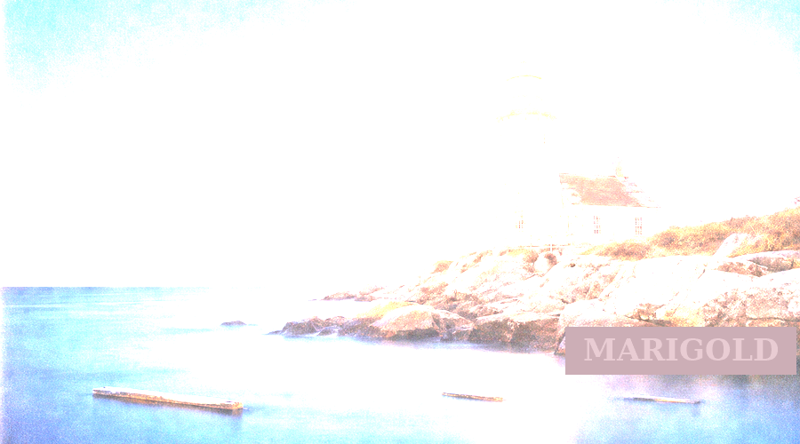
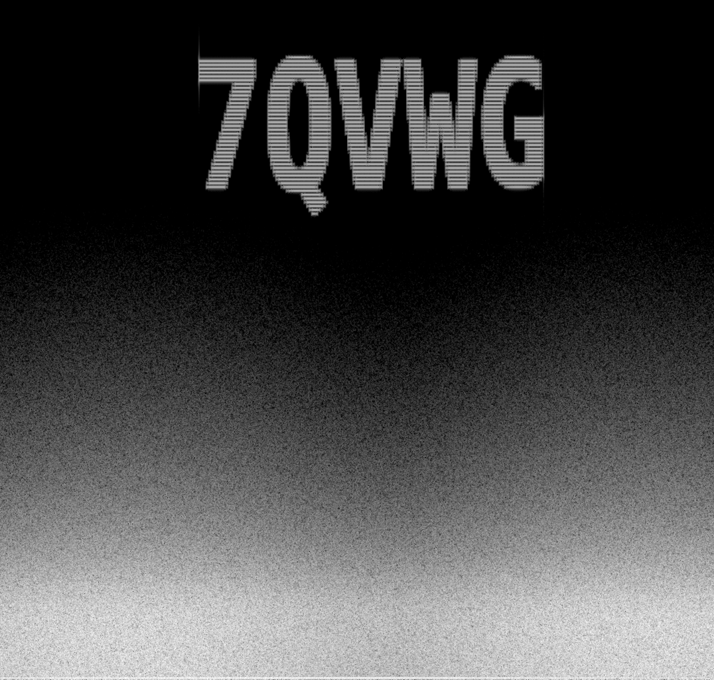

# Halvard’s Light

[中文](README.zh-CN.md) · Mimic CTF 2026 · Forensics · 300 points

| Category | Points | Input | Result |
|---|---:|---|---|
| Forensics | 300 | PNG with an appended ZIP | AES-GCM decryption |

[Original prompt and attachments](PROMPT.md) · [Official solution](https://ctf.rarebytehub.com/events/mimic/writeups/official-solution-halvard-s-light)

A PNG with a ZIP appended to it. The usual move is to carve it out with `binwalk` and unpack it, and that is most of the work here. But the answer is not in any extracted file: it sits in an **extra field of the ZIP local file header**, a field ordinary extraction does not present as a file.

## From the image to the hidden log

The PNG comment is a riddle: the dark water remembers the ship's name, and lowercase opens the hatch. It does not state the name. Stretch the dark pixels of the image into a visible range: `clip((RGB - 5) * 255 / 35, 0, 255)`. The enhanced sea shows **MARIGOLD**; lowercase `marigold` opens the ZIP. The levels are display choices, not cryptographic parameters.



Unpacking yields `keeper_log.txt` and `signal.wav`.

The log says to look at the audio as a picture. In the high-frequency band around 15–20 kHz, its spectrogram shows five characters:



```text
7QVWG
```

Those characters are not parsed automatically. The solver does not perform OCR; they are read visually and supplied as input.

The log also says something easier to skip: mind the header in front of each page. That points away from the ZIP's contents and toward the ZIP's own structure.

## The answer lives in the local header

A ZIP records file information in two places: a local file header per entry, and a central directory at the end. Standard tools read the central directory, but the extra fields in each header need not be identical. Here, the custom field appears only in the local header and is not extracted as a member file.

Following the log's hint, read the local file header's extra field and find field ID `0x7876`. Its value zlib-decompresses and then strictly Base64-decodes to 1720 bytes.

## The structure of those 1720 bytes

Offsets start at zero:

| Offset | Length | Content |
|---|---:|---|
| 0 | 3 | `LK1` marker |
| 3 | 1 | `0x73`, scheme text length 115 |
| 4 | 115 | `key=PBKDF2...` scheme description |
| 119 | 4 | big-endian `00 e4 e1 c0` = 15,000,000 iterations |
| 123 | 16 | salt |
| 139 | 12 | GCM nonce |
| 151 | 1569 | ciphertext plus a 16-byte authentication tag |

The salt is `cd05bed7bcdd7ffcd8cae695d87b1114` and the nonce is `9a26baf700aa0167ad76bd66`. Following the embedded description, derive 32 bytes from `marigold:7qvwg` with PBKDF2-HMAC-SHA256, then decrypt with AES-256-GCM and no additional authenticated data. The first line of the plaintext is the flag.

The scheme text is **length-prefixed**, not NUL-terminated. The zero byte at offset 119 belongs to the iteration count. Treating it as a terminator shifts every subsequent field. A parser should consume the declared 115 bytes and continue at offset 119.

Authentication and an exact re-encryption confirm the parsed parameters and offsets: encrypting again must reproduce the original ciphertext and tag byte for byte.

```text
RBH{the_light_was_for_the_living_7c60765a}
```

## Reproduction

Run from the repository root:

```powershell
python src/solvers/halvards-light/solve.py
python src/solvers/halvards-light/decrypt.py
```

The first script extracts the ZIP, audio spectrum, and image information; the second recovers the hidden log and needs `cryptography`. The solver parses its parameters from the original PNG rather than hard-coding the flag, and verifies that re-encryption matches the original ciphertext and tag. The five spectrogram characters are read visually, not recognized automatically.

Generated files are written to `outputs/halvards-light/`.

[Decrypt script](../../../src/solvers/halvards-light/decrypt.py)

[Reproducibility guide](../../REPRODUCIBILITY.md) · [Source and license](../../ABOUT.md)
