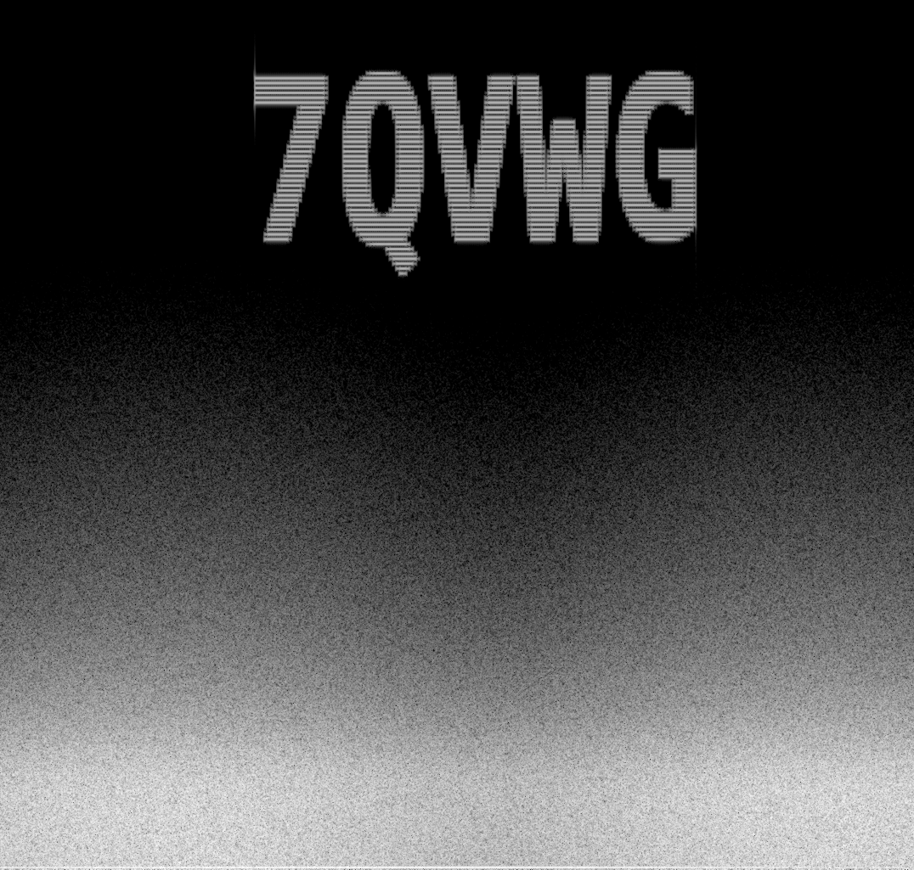

# Halvard’s Light

[English](README.en.md) · Mimic CTF 2026 · Forensics · 300 分

| 分类 | 分值 | 输入 | 结果 |
|---|---:|---|---|
| Forensics | 300 | 带尾部 ZIP 的 PNG | AES-GCM 解密 |

[原题与附件](PROMPT.md) · [官方题解](https://ctf.rarebytehub.com/events/mimic/writeups/official-solution-halvard-s-light)

一张 PNG，尾部挂着一个 ZIP。常规做法是 `binwalk` 一切、`unzip` 一解就完事，但这题的答案不在解出来的文件里——它在 ZIP 的**本地文件头扩展字段**里，一个常规解压不会作为文件输出的位置。

## 从图片到隐藏日志

PNG 的 Comment 是谜语：暗水记得船名，用小写打开舱门；它没有直接写出船名。将图像暗部按 `clip((RGB - 5) * 255 / 35, 0, 255)` 拉伸，海面上浮现 **MARIGOLD**，取小写 `marigold` 就能解开 ZIP。这组色阶用于显示，不是加密参数。


解压得到 `keeper_log.txt` 和 `signal.wav`。

日志里有一句关键提示：把音频当成图片看。观察约 15–20 kHz 的高频频谱，能看到五个字符：



```text
7QVWG
```

这五个字符不自动解析——脚本不做 OCR，是人工读图得到的输入。

日志还有一句更容易被忽略的话：注意每页内容前面的 header。这句把方向从「ZIP 里的文件」转到了「ZIP 本身的结构」。

## 答案在本地文件头里

一个 ZIP 有两个地方记录文件信息：每个文件自己的 local file header，和末尾集中的 central directory。两处扩展字段可以不同；本题的自定义字段仅存在于本地文件头，也不会被作为成员文件解压。

按日志的提示去读 local file header 的 extra field，找到字段 ID `0x7876`。它的值先 zlib 解压，再严格 Base64 解码，得到 1720 字节。

## 1720 字节的结构

偏移从零开始：

| 偏移 | 长度 | 内容 |
|---|---:|---|
| 0 | 3 | `LK1` 标识 |
| 3 | 1 | `0x73`，说明文本长度 115 |
| 4 | 115 | `key=PBKDF2...` 算法说明 |
| 119 | 4 | 大端 `00 e4 e1 c0` = 15,000,000 次 |
| 123 | 16 | salt |
| 139 | 12 | GCM nonce |
| 151 | 1569 | 密文及末尾 16 字节认证标签 |

salt 是 `cd05bed7bcdd7ffcd8cae695d87b1114`，nonce 是 `9a26baf700aa0167ad76bd66`。按内嵌说明，把 `marigold:7qvwg` 用 PBKDF2-HMAC-SHA256 派生 32 字节密钥，AES-256-GCM 解密，不附加 AAD。明文首行就是 flag。

说明文本使用**单字节长度前缀**，不以 NUL 结尾。偏移 119 的零字节属于迭代次数；若把它当作字符串终止符，后续字段都会错位。解析器应按长度读取 115 字节，并从偏移 119 继续。

认证标签校验和完整回编码能反向确认参数和偏移都对：重新加密必须得到与原密文和标签完全一致的结果。

```text
RBH{the_light_was_for_the_living_7c60765a}
```

## 复现

从仓库根目录运行：

```powershell
python src/solvers/halvards-light/solve.py
python src/solvers/halvards-light/decrypt.py
```

第一个脚本提取 ZIP、音频频谱和图像信息；第二个恢复隐藏日志，需要 `cryptography`。脚本从原 PNG 里解析参数，没有硬编码 flag，并验证重新加密结果与原密文及标签相同。频谱那五个字符由人工读图输入，不在脚本的自动识别范围内。

生成文件位于 `outputs/halvards-light/`。

[解密脚本](../../../src/solvers/halvards-light/decrypt.py)

[复现指南](../../REPRODUCIBILITY.md) · [来源与许可](../../ABOUT.md)
