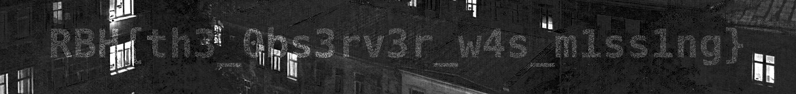

# Night 4,018

[中文](README.zh-CN.md) · Mimic CTF 2026 · Forensics · 100 points

| Category | Points | Input | Result |
|---|---:|---|---|
| Forensics | 100 | PNG | PNG height repair and chromatic contrast |

[Original prompt and attachments](PROMPT.md) · [Official solution](https://ctf.rarebytehub.com/events/mimic/writeups/official-solution-night-4-018)

The IHDR claims 741 rows. The pixel stream contains 941. The extra 200 rows are where the answer lives — but first the difference has to be shown to be real rather than a stride mistake.

## Rule out the decoy first

A ZIP is appended to the PNG. Its `night_log.txt` says outright that it is a decoy and Base64-encodes `RBH{th3_m00n_w4tch3d_4017}`.

The extracted log identifies this as a decoy, so the real flag must be elsewhere and must look different. The point of this step is to **avoid submitting something that merely resembles a flag**.

## The height does not add up

The PNG is 1672 pixels wide, RGB8, non-interlaced. Each row is one filter byte plus 1672×3 pixel bytes, so stride = 5017.

Decompress the IDAT data and divide its length by the stride:

```text
941 rows (IHDR declares 741)
```

The inflated IDAT length is `941 * 5017 = 4,720,997` bytes, whereas the header describes only `741 * 5017 = 3,717,597` bytes. Compare the computed row count with the declared count after confirming RGB8 and non-interlaced scanlines. The script validates every chunk CRC first to confirm the file itself is intact, then rewrites only the IHDR height field and recomputes that chunk's CRC, leaving the compressed pixel stream untouched.

## Reading the extra 200 rows

Viewed directly they are noise, because the hidden text and the background have almost the same **luminance**.

Change colour space instead. Convert RGB to linear values through the sRGB transfer function, into XYZ, normalise against the D65 white point, then take the red-green difference:

```text
a* = 500 * (f(X/Xn) − f(Y/Yn))
```

f is linear near zero and a cube root at larger values. Stretch the a* channel over the 200 new rows from the 1st to the 99th percentile into 0..255.

That is why luminance stretching alone fails: the contrast is not in the luminance channel, it is in the red-green difference. The 1%/99% percentiles are display parameters chosen to surface the text, not constants from the prompt.



Reading the recovered image gives:

```text
RBH{th3_0bs3rv3r_w4s_m1ss1ng}
```

Noisy regions still require visual reading; the script does not perform OCR.

## Reproduction

```powershell
python src/solvers/night-4018/solve.py
```

[Complete solver](../../../src/solvers/night-4018/solve.py). Requires numpy and Pillow.

Generated images are written to `outputs/night-4018/`.

Keep the order: validate the structure, repair the height, then process colour. Done in the opposite order, the fake flag in the trailing ZIP tends to win.

[Reproducibility guide](../../REPRODUCIBILITY.md) · [Source and license](../../ABOUT.md)
