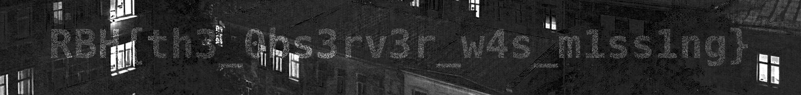

# Night 4,018

[English](README.en.md) · Mimic CTF 2026 · Forensics · 100 分

| 分类 | 分值 | 输入 | 结果 |
|---|---:|---|---|
| Forensics | 100 | PNG | PNG 高度修复与色差增强 |

[原题与附件](PROMPT.md) · [官方题解](https://ctf.rarebytehub.com/events/mimic/writeups/official-solution-night-4-018)

图片在 IHDR 里说自己是 741 行。按像素流算，它有 941 行。差出来的 200 行就是这个题的答案——但先得让人相信这个差值是真的，不是 stride 算错了。

## 先排除一个诱饵

PNG 尾部挂着一个 ZIP，里面的 `night_log.txt` 直接写着自己是 decoy，还 Base64 给出一串 `RBH{th3_m00n_w4tch3d_4017}`。

提取出的日志明说这是诱饵。所以真正的 flag 一定在别处，而且形态应该和它不一样。这一步的意义在于：**避免拿一个看起来像 flag 的东西交差**。

## 高度对不上

PNG 是 1672 像素宽、RGB8、非交错。每行 = 1 个过滤器字节 + 1672×3 个像素字节，所以 stride = 5017。

把 IDAT 数据解压，长度除以 5017：

```text
941 行（IHDR 声明 741）
```

解压后的 IDAT 为 `941 * 5017 = 4,720,997` 字节，头部声明只对应 `741 * 5017 = 3,717,597` 字节。确认 RGB8、非交错后，应比较实际行数和声明行数。脚本先把所有 chunk 的 CRC 校验一遍，确认文件本身没坏，再只改 IHDR 的高度字段并重算该 chunk 的 CRC，压缩像素流原封不动保留下来。

## 新增的 200 行怎么读

直接看是噪点。原因是隐藏文字和背景的**亮度**几乎一样。

换个色彩空间：RGB 先按 sRGB 传递函数转线性值，再转 XYZ，以 D65 白点归一化，然后算红绿差：

```text
a* = 500 * (f(X/Xn) − f(Y/Yn))
```

f 在小值区是线性的、大值区取立方根。对新增那 200 行的 a* 通道取 1%/99% 分位拉伸到 0..255。

这就是为什么只拉伸亮度没用：对比度不在亮度通道里，在红绿差里。百分位拉伸的 1% 和 99% 是显示参数，选它是为了让隐藏文字浮出来，不是题面给的常量。



从恢复出来的图上可以读出：

```text
RBH{th3_0bs3rv3r_w4s_m1ss1ng}
```

噪声区域仍需人工辨读，脚本不负责 OCR。

## 复现

```powershell
python src/solvers/night-4018/solve.py
```

[完整脚本](../../../src/solvers/night-4018/solve.py)。依赖 numpy、Pillow。

生成图片位于 `outputs/night-4018/`。

顺序建议照原样：先验结构、再修高度、最后处理颜色。反过来的话，很容易被尾部那个假 flag 带走。

[复现指南](../../REPRODUCIBILITY.md) · [来源与许可](../../ABOUT.md)
