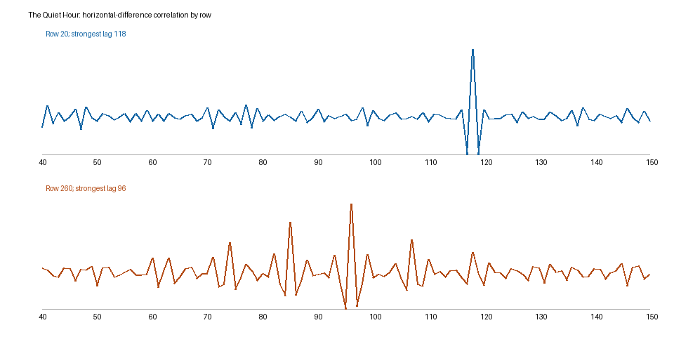
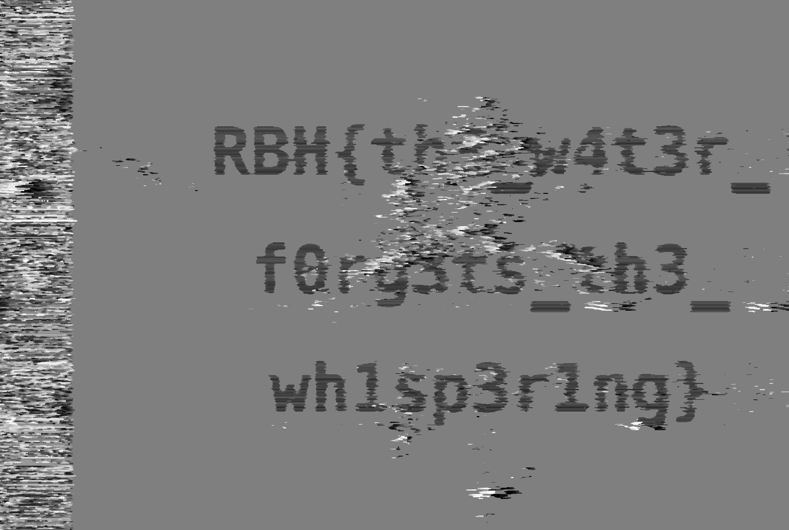

# The Quiet Hour

[中文](README.zh-CN.md) · Mimic CTF 2026 · Forensics · 300 points

| Category | Points | Input | Result |
|---|---:|---|---|
| Forensics | 300 | PNG | Autostereogram disparity recovery |

[Original prompt and attachments](PROMPT.md) · [Official solution](https://ctf.rarebytehub.com/events/mimic/writeups/official-solution-the-quiet-hour)

From a distance it is a landscape; up close it is all noise. The noise is not random — repeating textures are visible within each row. The repeat distance shifts locally, and the shifts spell something. That is an autostereogram. Viewing it with your eyes is one thing; recovering the disparity in code is another.

## The period is not global

The input `the_quiet_hour.png` is 1400×940 RGB. Take a horizontal first difference per row, correlate over displacements from 40 to 150 pixels, and pick each row's peak independently.

That result rules out a natural assumption: **one fixed period for the whole image**. The period quantiles here are roughly 92, 100, 110, 121, and 128 — a spread of nearly 40 pixels, so any single value misaligns a large share of rows.

The plot below uses zero-based rows 20 and 260. The first has a dominant lag 118; the text row has its strongest peak at 96 and a secondary peak at 85. A shorter local repeat distance is the observation that motivates searching for disparity rather than extracting pixel bits. Each curve is independently rescaled for display; compare peak locations, not heights between panels.



## Finding the disparity per pixel

Centre the search on that row's own period `P_y` and enumerate `delta = -25..25`. Compare the row's difference image against its version shifted left by `P_y + delta`, score with squared RGB error, smooth horizontally over 15 pixels, and keep the delta with the lowest cost at each pixel.

Two post-processing steps: a 3×7 median filter to remove isolated noise, then map `(delta + 25) * 255 / 50` to greyscale.

The ±25 range, the 15-pixel smoothing, and the 3×7 filter are implementation choices, not constants from the prompt. Whether they are appropriate is judged by the period distribution and by the final image together. There is no single correct answer.

One side effect has to be understood: the script indexes modulo the image width, so the left edge shows wraparound artefacts. That garbled strip is not hidden content.



```text
RBH{th3_w4t3r_f0rg3ts_th3_wh1sp3r1ng}
```

Note that both `1` characters in `wh1sp3r1ng` are digits — easy to misread as `i`.

## Two traps

**Harmonics**: a correlation peak near 372 can be the third harmonic of a true period near 124. A single highest peak can therefore select an incorrect period, so the estimate should consider the distribution.

**Channels**: neither LSB nor luminance enhancement reveals this relationship, because the information is not in pixel values at all — it is in the displacement between pixels.

Cost is roughly O(HWD) for the period search with D=111, and O(HWK) for local matching with K=51. Space goes mainly to the image, error, and disparity arrays.

The official method similarly detects a shorter repetition inside the text, using normalized high-frequency grain. This solver retains a separate RGB first-difference cost and per-row period search; agreement is checked in the recovered image.

## Reproduction

```powershell
python src/solvers/the-quiet-hour/solve.py
```

[Complete solver](../../../src/solvers/the-quiet-hour/solve.py). Requires numpy, Pillow, and scipy. It writes `recovered.png` and `disparity.npy` to `outputs/the-quiet-hour/`; the final text is read from the image by eye.

[Reproducibility guide](../../REPRODUCIBILITY.md) · [Source and license](../../ABOUT.md)
