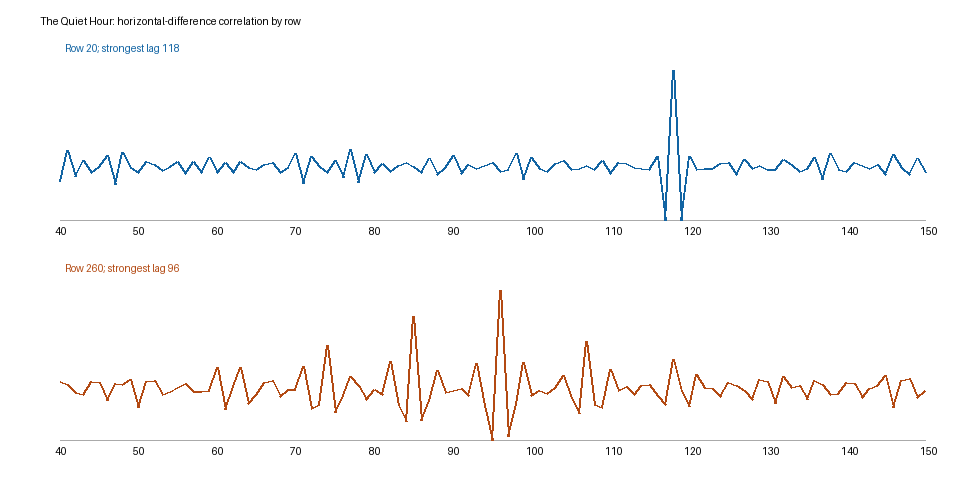
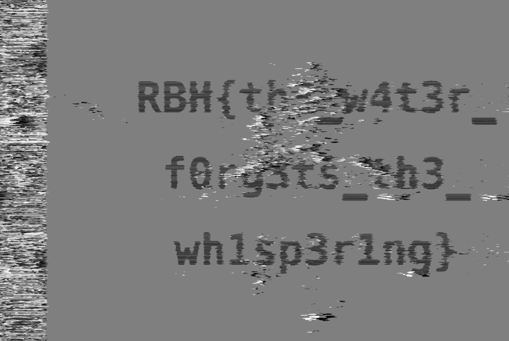

# The Quiet Hour

[English](README.en.md) · Mimic CTF 2026 · Forensics · 300 分

| 分类 | 分值 | 输入 | 结果 |
|---|---:|---|---|
| Forensics | 300 | PNG | 自动立体图视差恢复 |

[原题与附件](PROMPT.md) · [官方题解](https://ctf.rarebytehub.com/events/mimic/writeups/official-solution-the-quiet-hour)

远看是一张风景图，近看全是噪点。但这不是随机噪声——同一行里能看出重复的纹理。重复的距离在局部被改变，改变量就藏着字。这类图叫自动立体图（autostereogram），裸眼看是一回事，用代码算视差是另一回事。

## 周期不是全图固定的

输入 `the_quiet_hour.png` 是 1400×940 RGB。对每行做水平一阶差分，然后在 40 到 150 像素的位移范围内算相关性，每行独立取峰值。

结果直接否掉了一个自然假设：**全图用一个固定周期**。当前数据的周期分位数大约是 92、100、110、121、128——跨度接近 40 像素，固定成任何一个值都会让相当一部分行匹配错。

下图取零起始行号 20 和 260。前者主峰为位移 118；文字行主峰为 96，另有 85 的次峰。局部重复距离缩短，是改做视差恢复的依据。两条曲线分别缩放显示，应比较峰的位置，不能跨图比较峰高。



## 逐像素找视差

以该行自己的周期 `P_y` 为中心，枚举 `delta = -25..25`。做法是把该行的差分图与左移 `P_y + delta` 的差分图比，代价取 RGB 平方误差，再在水平方向做 15 像素的均值平滑，最后每个像素选代价最小的 delta。

后处理两步：3×7 中值滤波去掉孤立噪点，再按 `(delta + 25) * 255 / 50` 映射成灰度。

搜索范围 ±25、平滑窗口 15、滤波 3×7 都是实现选择，不是题面常量。它们是否合适，由周期分布和最终图像共同检验，没有唯一的正确答案。

还有一个必须知道的副作用：脚本用的是按宽度取模的索引，所以左边缘会出现绕回伪影。那段花屏不是隐藏内容。



```text
RBH{th3_w4t3r_f0rg3ts_th3_wh1sp3r1ng}
```

注意 `wh1sp3r1ng` 里两个 `1` 都是数字，很容易读成 `i`。

## 两个坑

**谐波**：相关峰里检测到约 372 的峰，它可以是真实周期约 124 的三次谐波。只挑最高的峰会挑错，所以周期要用分布看，不是取最大值。

**通道**：LSB 和亮度增强都看不到这种几何关系，因为信息不在像素值里，在像素之间的位移里。

复杂度方面，周期搜索约 O(HWD)，D=111；局部匹配 O(HWK)，K=51。空间主要花在图像、误差和视差三个数组上。

官方也通过文字内部更短的重复距离恢复内容，采用归一化的高频纹理。这里保留独立的 RGB 一阶差分代价与逐行周期搜索，由恢复出的文字图核对结果。

## 复现

```powershell
python src/solvers/the-quiet-hour/solve.py
```

[完整脚本](../../../src/solvers/the-quiet-hour/solve.py)。依赖 numpy、Pillow、scipy。`recovered.png` 和 `disparity.npy` 写入 `outputs/the-quiet-hour/`，最终文字人工辨读。

[复现指南](../../REPRODUCIBILITY.md) · [来源与许可](../../ABOUT.md)
