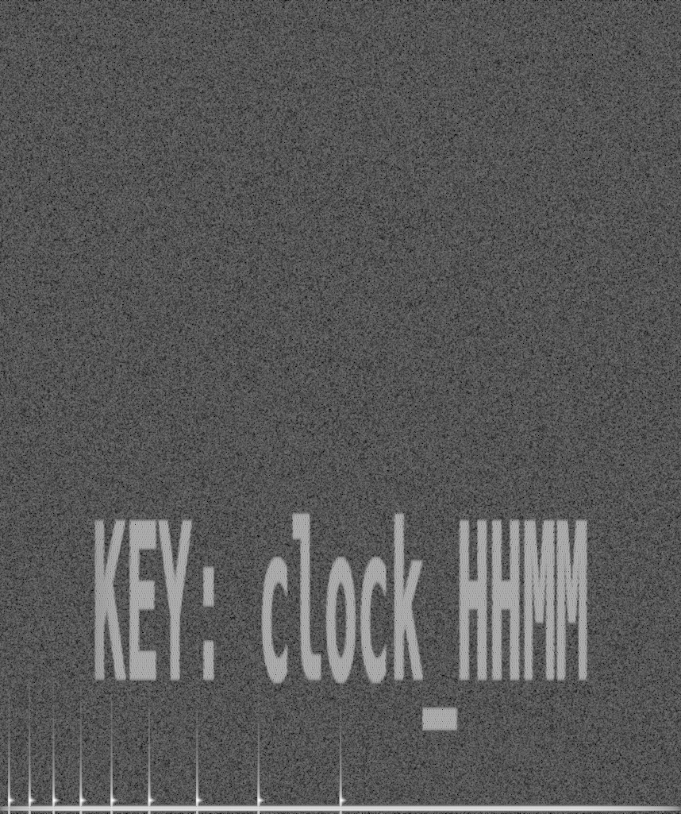
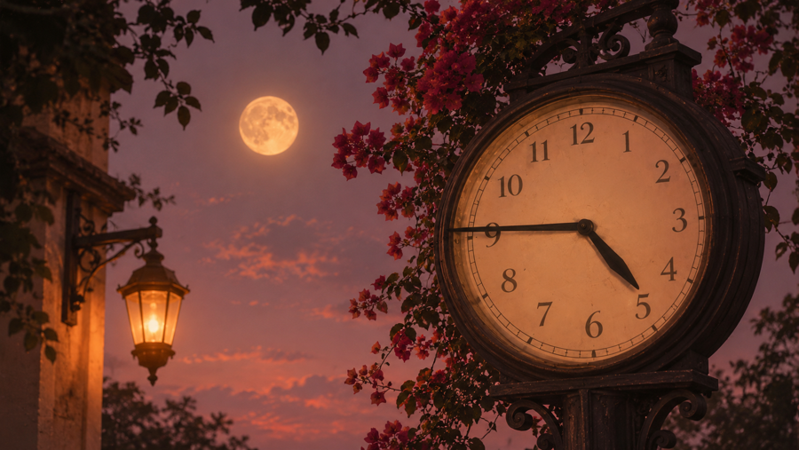
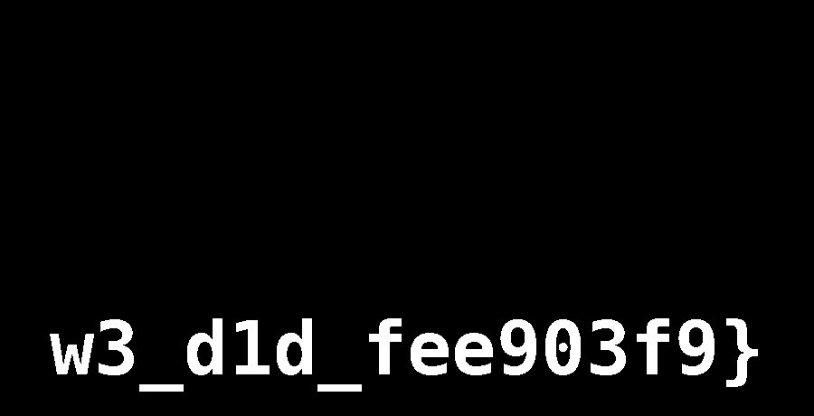

# The Stopped Clock

[中文](README.zh-CN.md) · Mimic CTF 2026 · Forensics · 100 points

| Category | Points | Input | Result |
|---|---:|---|---|
| Forensics | 100 | PNG, audio, and a torn page | Spectrogram, ZIP, and bit plane |

[Original prompt and attachments](PROMPT.md) · [Official solution](https://ctf.rarebytehub.com/events/mimic/writeups/official-solution-the-stopped-clock)

This one is a pipeline: a photo reveals an appended ZIP, the ZIP holds a voice message and an encrypted diary, the voice supplies the diary password, the diary gives the first half of the flag, and the torn page gives the second half. Break any link and it stops, but every link has a clear signal.

## Locate the ZIP at the PNG boundary

Use the original attachment as shipped with the solver, `last_seen.png` (3,449,566 bytes, SHA-256 `8d1bad7d…5cf6`).

The ZIP sits after the PNG's IEND. That means the image **must not be re-exported or re-compressed**: any re-encode destroys the appended data.

Nor should you locate it by blindly scanning the compressed stream for `PK` — that readily hits coincidental bytes inside pixel data. The script walks the PNG chunk boundaries instead, so reaching IEND tells it exactly where the tail begins.

After reading the Base64 hint in the tEXt comment and parsing the appended ZIP, two files come out: `voicemail.wav` and `leo_diary.zip`. The audio is 22050 Hz, mono, 20 seconds.

The PNG comment decodes to: “Every picture is bigger than it looks. Follow it all the way to the end - something is waiting for you there.” It points to bytes beyond the displayed image. ZIP readers that support a prepended stub can also open the full PNG directly; walking PNG chunks is the extraction technique used here.

## The spectrogram gives a format, not a password

Render the spectrum with a 2048-point Hann window, hop = 512, logarithmic magnitude, and a 90 dB display range, time to the right and frequency up:



What the spectrogram states is not the password but its shape: `KEY: clock_HHMM`. The digits come from the image — the clock face reads 04:45, so the password is `clock_0445`.

The solver takes the password as input read from the image. It does not pretend to recognise the clock face automatically.

The long minute hand points at 9 (45 minutes); the shorter hour hand lies between 4 and 5, close to 5. Therefore use **04:45**, not 05:45.



## The diary gives the first half

A Base64 blob at the end of the diary decodes to:

```text
RBH{t1me_n3v3r_st0pp3d_
```

An unclosed flag — the first half, waiting on the rest.

## The torn page gives the second half

The hint is red ink / faintest layer, which points at bit 0 of the R channel. Compute `(R & 1) * 255` per pixel of `torn_page.png` and lay the results out as an image:



The crucial detail: the least significant bit is **rendered as an image and read visually**, not packed into ASCII bytes. Packing produces noise.

Reading the bit plane gives the suffix:

```text
w3_d1d_fee903f9}
```

Together:

```text
RBH{t1me_n3v3r_st0pp3d_w3_d1d_fee903f9}
```

## Reproduction

```powershell
python src/solvers/the-stopped-clock/solve.py
```

[Complete solver](../../../src/solvers/the-stopped-clock/solve.py). Requires numpy and Pillow. The script verifies the ZIP password, decodes the first-half Base64, and renders the second-half image; reading the final text remains a human step.

Generated files are written to `outputs/the-stopped-clock/`.

[Reproducibility guide](../../REPRODUCIBILITY.md) · [Source and license](../../ABOUT.md)
