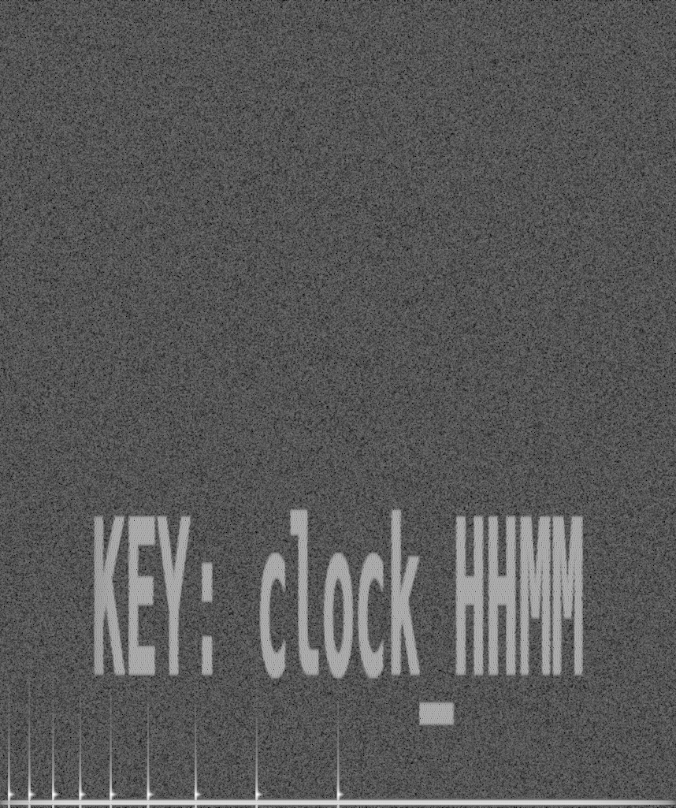
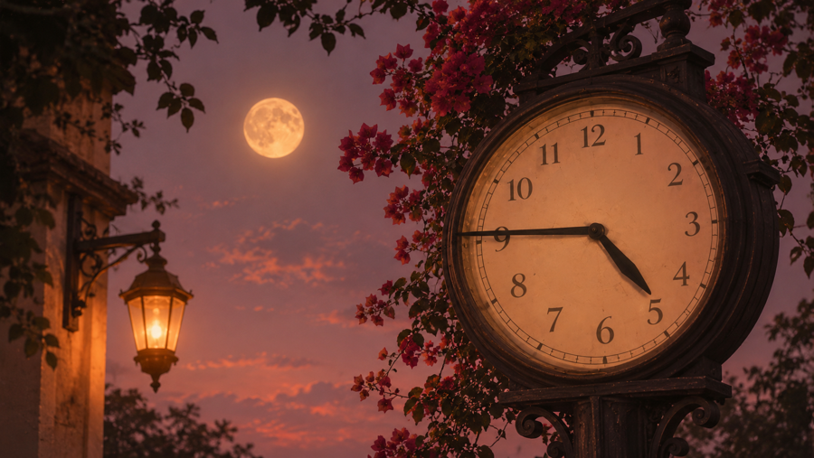
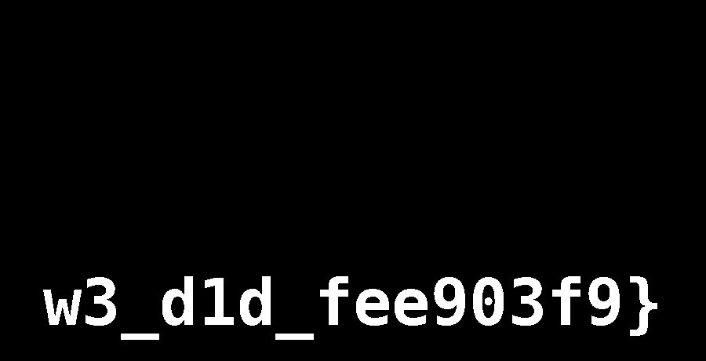

# The Stopped Clock

[English](README.en.md) · Mimic CTF 2026 · Forensics · 100 分

| 分类 | 分值 | 输入 | 结果 |
|---|---:|---|---|
| Forensics | 100 | PNG、音频与撕页图 | 频谱、ZIP 与位平面 |

[原题与附件](PROMPT.md) · [官方题解](https://ctf.rarebytehub.com/events/mimic/writeups/official-solution-the-stopped-clock)

这题是流水线：一张照片牵出尾部 ZIP，ZIP 里有语音和加密日记，语音解出日记口令，日记给前半 flag，撕页图给后半。任何一环断了都走不到底，但每一环的信号都很明确。

## 从 PNG 边界定位尾部 ZIP

用随脚本保存的原始附件 `last_seen.png`（3,449,566 字节，SHA-256 `8d1bad7d…5cf6`）。

ZIP 挂在 PNG 的 IEND 之后。这意味着：**不能重新导出或压缩这张图**，任何一次重编码都会把尾部数据抹掉。

定位方式也不用在压缩流里盲搜 `PK`——那样很容易命中像素数据里的巧合字节。脚本按 PNG 的 chunk 边界逐个走，走到 IEND 就知道尾部从哪里开始。

读完 tEXt Comment 里的 Base64 提示，解析尾部 ZIP，得到两个文件：`voicemail.wav` 和 `leo_diary.zip`。语音是 22050 Hz、单声道、20 秒。

PNG Comment 解码内容是：Every picture is bigger than it looks. Follow it all the way to the end - something is waiting for you there. 即图像比看上去更大，应检查显示图像结束后的字节。支持前置数据的 ZIP 读取器也能直接打开整张 PNG；这里采用 PNG chunk 边界定位尾部。

## 频谱给的是格式，不是口令

用 2048 点 Hann 窗、hop = 512、幅度取对数、显示范围 90 dB 画频谱，时间向右、频率向上：



频谱上写的不是明文口令，是格式：`KEY: clock_HHMM`。具体数字要去图里看——钟面停在 04:45，所以口令是 `clock_0445`。

脚本把口令当成人工读图得到的输入，没有假装能自动识别钟面。

长分针指向 9，即 45 分；短时针在 4 与 5 之间并接近 5，因此读作 **04:45**，不是 05:45。



## 日记给前半

日记末尾有一段 Base64，解出来是：

```text
RBH{t1me_n3v3r_st0pp3d_
```

到这里得到一个未闭合的 flag——前半段，等后半补上。

## 撕页图给后半

提示是 red ink / faintest layer，指向 R 通道的最低位。对 `torn_page.png` 的每个像素算 `(R & 1) * 255`，直接排成一张黑白图：



重点在这里：是**把最低位渲染成图像再读**，不是把所有位拼成 ASCII 字节流。后者出来的是乱码。

从位平面读出后缀：

```text
w3_d1d_fee903f9}
```

拼起来就是完整的：

```text
RBH{t1me_n3v3r_st0pp3d_w3_d1d_fee903f9}
```

## 复现

```powershell
python src/solvers/the-stopped-clock/solve.py
```

[完整脚本](../../../src/solvers/the-stopped-clock/solve.py)。依赖 numpy、Pillow。脚本负责校验 ZIP 口令、解码前半 Base64、生成后半文字图；最后一步读图仍然是人来做。

生成文件位于 `outputs/the-stopped-clock/`。

[复现指南](../../REPRODUCIBILITY.md) · [来源与许可](../../ABOUT.md)
