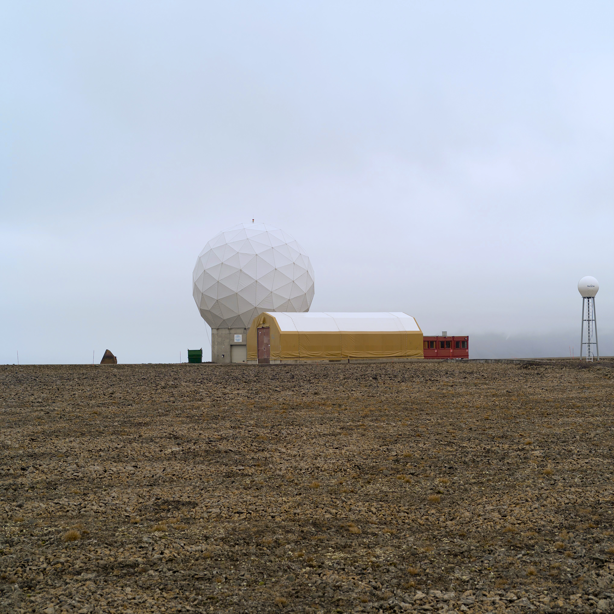

# Project Borealis: The Arctic Shadow

[中文](README.zh-CN.md) · Mimic CTF 2026 · OSINT · 300 points · [Challenge page](https://ctf.rarebytehub.com/events/mimic/writeups/challenge/project-borealis-the-arctic-shadow)

| Category | Points | Input | Result |
|---|---:|---|---|
| OSINT | 300 | Photograph and public sources | Station and vessel identification |

[Original prompt and attachments](PROMPT.md) · [Official solution](https://ctf.rarebytehub.com/events/mimic/writeups/official-solution-project-borealis-the-arctic-shadow) · [Event links](../../OFFICIAL-LINKS.md)

The hard part of OSINT is rarely finding material — it is deciding which of several candidates is the right one. The four clues here each pin a single field, and one wrong field breaks the flag, so every step can be checked.

## What the prompt supplies

- January 2022, polar night
- A satellite ground station lost one of its two subsea fibre cables
- A trawler repeatedly crossed the same seabed before the break
- The station name has 7 letters; the flag format is `RBH{STATION_IMO_CALLSIGN}`

The first three are search conditions. The fourth is a filter — a 7-letter constraint eliminates most candidates outright.

## Pinning the station

[Space Norway's incident notice](https://spacenorway.com/news/redundancy-on-primary-telecom-connection-to-svalbard-restored/) documents two subsea cables to Svalbard. One failed at **2022-01-07 04:10 CET**, and redundancy was restored through a temporary path on 18 January.

One reading trap: the failure removed **redundancy**, while communication continued over the other link. Searching for an outage points the wrong way.

[Space Norway's cable description](https://spacenorway.com/infrastructure/subsea-fibre-cables/fibre-optic-cables/) states that both links serve **SvalSat**. [USGS's SvalSat page](https://eros.usgs.gov/earthshots/svalsat) confirms the name, the high-latitude position, and the subsea connection to Tromsø.

`SVALSAT` is exactly 7 letters, matching the prompt.



The photograph shows a rocky plateau, a large white radome on the left, a yellow shed-like structure beside it, a red building behind, and a small white sphere on a four-legged tower to the right. The image carries **no location EXIF**, so the station name does not come from coordinates. It comes from the incident record and the letter count. The original camera position was never independently matched, and is not needed for this incident-source route.

## Pinning the vessel

[Polar Journal's report](https://polarjournal.net/suspicious-manoeuvres-over-svalbards-undersea-cables/) cites AIS tracks in the area: the trawler **Melkart 5** crossed the relevant zone repeatedly.

Mind the report's own wording — it does not establish intent to damage the cable, only the track. The article should not claim more than the source.

[VesselFinder's IMO 9130183 page](https://www.vesselfinder.com/vessels/details/9130183) supplies two fields:

| Field | Value |
|---|---|
| Station | SVALSAT |
| Vessel | MELKART-5 |
| IMO number | 9130183 |
| Radio call sign | UBYQ2 |

The prompt asks for the IMO and the radio call sign. MMSI or the vessel name cannot stand in for either — they belong to different identifier systems, and substituting one breaks the answer.

## Assembling the flag

```text
RBH{SVALSAT_9130183_UBYQ2}
```

The official solution starts by identifying SvalSat from the photograph, then follows the cable incident. This article follows the incident records first and checks the station and vessel fields through separate sources; both routes reach the same identifiers.

## Source map

| Question | Source | Key information |
|---|---|---|
| Was there a single-cable failure in 2022 | Space Norway | failure date, two links, restored redundancy |
| Which station do the cables serve | Space Norway / USGS | SvalSat, Tromsø, high-latitude position |
| Which vessel showed an unusual track | Polar Journal | Melkart 5's AIS activity |
| The two vessel identifiers | VesselFinder | IMO 9130183, call sign UBYQ2 |

[Reproducibility guide](../../REPRODUCIBILITY.md) · [Source and license](../../ABOUT.md)
