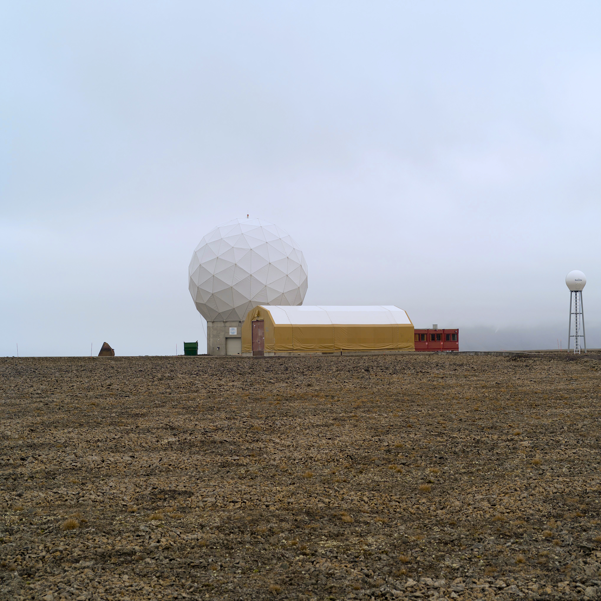

# Project Borealis: The Arctic Shadow

[English](README.en.md) · Mimic CTF 2026 · OSINT · 300 分 · [题目页面](https://ctf.rarebytehub.com/events/mimic/writeups/challenge/project-borealis-the-arctic-shadow)

| 分类 | 分值 | 输入 | 结果 |
|---|---:|---|---|
| OSINT | 300 | 照片与公开来源 | 站点和船舶识别 |

[原题与附件](PROMPT.md) · [官方题解](https://ctf.rarebytehub.com/events/mimic/writeups/official-solution-project-borealis-the-arctic-shadow) · [赛事链接](../../OFFICIAL-LINKS.md)

OSINT 题的难点通常不是搜不到，是搜到一堆之后没法确定哪个才是。这题给的四条线索各自锁一个字段，一条不对整个 flag 就不对，所以可以逐项验证。

## 题面给了什么

- 2022 年 1 月，极夜
- 一座卫星地面站失去两条海底光缆中的一条
- 一艘拖网渔船在断缆前反复经过同一片海床
- 站名 7 个字母，flag 格式 `RBH{STATION_IMO_CALLSIGN}`

前三条是检索条件，第四条是校验条件——7 个字母这个约束能直接否掉大部分候选。

## 先锁站名

[Space Norway 的事件通告](https://spacenorway.com/news/redundancy-on-primary-telecom-connection-to-svalbard-restored/)记录了两条斯瓦尔巴海底光缆。其中一条在 **2022-01-07 04:10 CET** 故障，1 月 18 日通过临时链路恢复了冗余。

这里有个容易读错的地方：事故失去的是**通信冗余**，另一条链路仍维持通信。如果按「断网」去搜，方向就偏了。

[Space Norway 的光缆说明](https://spacenorway.com/infrastructure/subsea-fibre-cables/fibre-optic-cables/)指出这两条链路服务的是 **SvalSat**。[USGS 的 SvalSat 页面](https://eros.usgs.gov/earthshots/svalsat)进一步确认了站名、高纬位置，以及通往 Tromsø 的海底光缆连接。

`SVALSAT` 正好 7 个字母，与题面一致。



照片里有岩石台地、左侧一座大型白色球形天线罩、旁边黄色棚状结构、后方红色建筑，以及右侧四腿塔上的小型白色球体。照片**没有拍摄位置 EXIF**，所以站名不是从照片坐标读出来的，是靠事故资料和字母数确认的。这里采用事故资料路线，没有独立匹配照片的精确拍摄视角。

## 再锁船

[Polar Journal 的报道](https://polarjournal.net/suspicious-manoeuvres-over-svalbards-undersea-cables/)引用了事发海域的 AIS 轨迹：渔船 **Melkart 5** 曾反复穿过相关区域。

注意报道本身的措辞——它没有证明船员故意破坏光缆，只描述了轨迹。文章里不该比来源多说一句。

[VesselFinder 的 IMO 9130183 页面](https://www.vesselfinder.com/vessels/details/9130183)给出两个字段：

| 字段 | 值 |
|---|---|
| Station | SVALSAT |
| Vessel | MELKART-5 |
| IMO number | 9130183 |
| Radio call sign | UBYQ2 |

题面要的是 IMO 和 radio call sign。MMSI 或船名不能替代这两个字段——它们是不同的标识体系，填错一个就不对。

## 拼起来

```text
RBH{SVALSAT_9130183_UBYQ2}
```

官方先从照片识别 SvalSat，再追查断缆事件。本文先查事故资料，再用独立来源确认站点和船舶字段，两条路线得到相同标识。

## 来源对照

| 问题 | 来源 | 关键信息 |
|---|---|---|
| 2022 年是否发生单缆故障 | Space Norway | 故障日期、两条链路、冗余恢复 |
| 光缆服务哪个站点 | Space Norway / USGS | SvalSat、Tromsø、高纬位置 |
| 哪艘船有异常轨迹 | Polar Journal | Melkart 5 的 AIS 活动 |
| 船舶的两个识别字段 | VesselFinder | IMO 9130183、呼号 UBYQ2 |

[复现指南](../../REPRODUCIBILITY.md) · [来源与许可](../../ABOUT.md)
